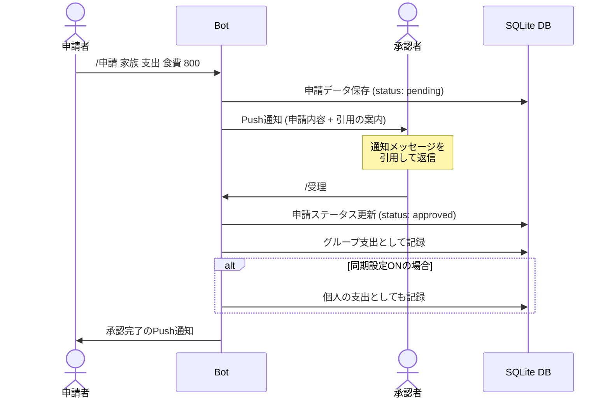
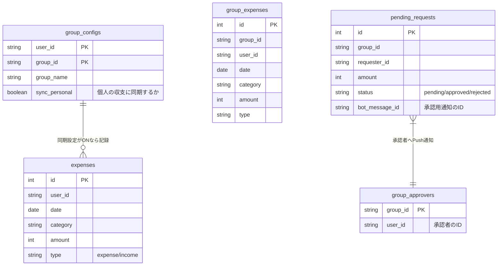

### 概要

LINE のトークルームに追加するだけで、個人・グループの収支を記録・集計できる Bot。
外部サービスへの依存を最小限に抑え、Go 標準ライブラリ + SQLite のみで動作する。

### 主な機能

- **収支記録** — コマンド（`/支出`・`/収入`）またはフリーテキストで入力
- **月次・全期間集計** — カテゴリ別の収支サマリーをテキストで返信
- **申請** — 個人チャットからグループへ申請し、承認者が LINE の引用機能で受理・却下
- **グループ同期** — グループの記録を個人収支に自動ミラーリングする設定
- **メンバー別集計** — グループ内の支出をメンバーごとに集計

### 技術的なポイント

- SQLite の WAL モード + `SetMaxOpenConns(1)` で並行書き込みを安全に制御
- LINE の「引用メッセージ」機能を活用し、承認操作を簡潔に実現

### システム構成図

#### 申請・承認

申請時のフローです。LINE の引用機能を使用することで、どのデータの申請か、どの申請が受理されたかをわかりやすく表示する。

#### データベース設計 (ER 図)

グループごとの承認者や、個人とグループの同期設定を管理するシンプルなリレーショナル構造を採用しています。

### リンク
- [LINE アカウント](https://lin.ee/ZSe3npR)

**技術スタック:** Go / SQLite / LINE Messaging API
